<div align="center">

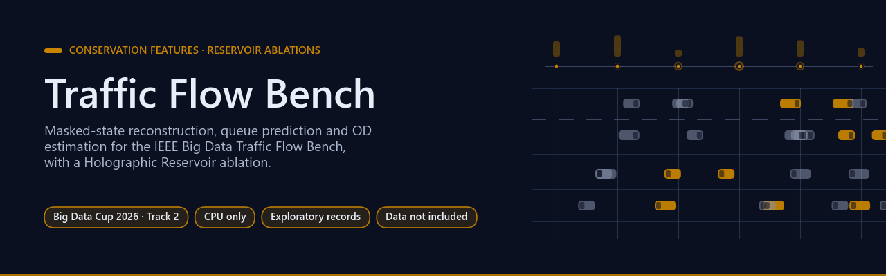

# Traffic Flow Bench — conservation features and reservoir ablations

[](https://github.com/Agnuxo1/traffic-flow-hrc-2026/actions/workflows/release.yml) [](LICENSE)  [](docs/RESEARCH_PROTOCOL.md) [](https://www.kaggle.com/competitions/2026-ieee-big-data-traffic-flow-bench)

[**Current evidence**](#current-evidence) · [**Reproduce**](#reproduce) · [**Scientific comparison**](#scientific-comparison) · [**Experiment log**](experiments/LOG.csv) · [**Implementation**](code/README.md) · [**Protocol**](docs/RESEARCH_PROTOCOL.md) · [**Reproduction gap**](docs/REPRODUCTION_GAP.md)

</div>

Implementation for [IEEE Big Data Traffic Flow Bench](https://www.kaggle.com/competitions/2026-ieee-big-data-traffic-flow-bench), combining masked-state reconstruction, queue prediction and OD estimation with the author's [Holographic Reservoir](https://github.com/Agnuxo1/Holographic-Reservoir).

**Contents** — [Current evidence](#current-evidence) · [Reproduce](#reproduce) · [Scientific comparison](#scientific-comparison) · [Background](#background) · [Real-world applications](#real-world-applications) · [Possible improvements](#possible-improvements) · [Future work](#future-work) · [Bibliography](#bibliography)

## Current evidence

<p align="center">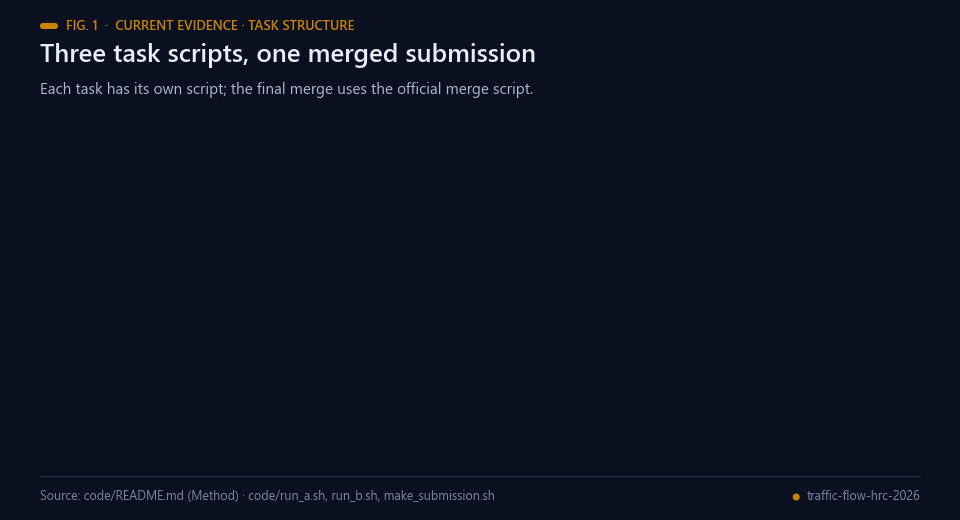<br><sub>Fig. 1 — Task structure. Source: code/README.md.</sub></p>

<p align="center">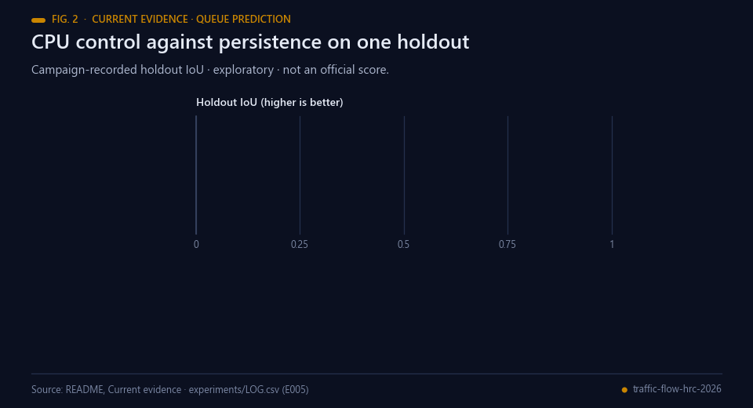<br><sub>Fig. 2 — Campaign-recorded holdout IoU; exploratory, not an official score. Data: README and experiments/LOG.csv (E005).</sub></p>

The CPU control for queue prediction has a campaign-recorded holdout IoU of approximately 0.667, compared with persistence approximately 0.41. The 32-unit reservoir comparison and state-reconstruction runs are still incomplete. The OD solution uses non-negative prior-regularised least squares with lambda 0.05. These are exploratory local records, not independently verified official scores or a demonstrated reservoir gain. Detailed logs remain in [experiments](experiments).

<p align="center">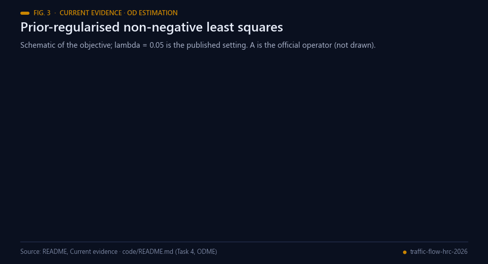<br><sub>Fig. 3 — Schematic of the OD objective (illustrative form; lambda 0.05 as published).</sub></p>

<p align="center">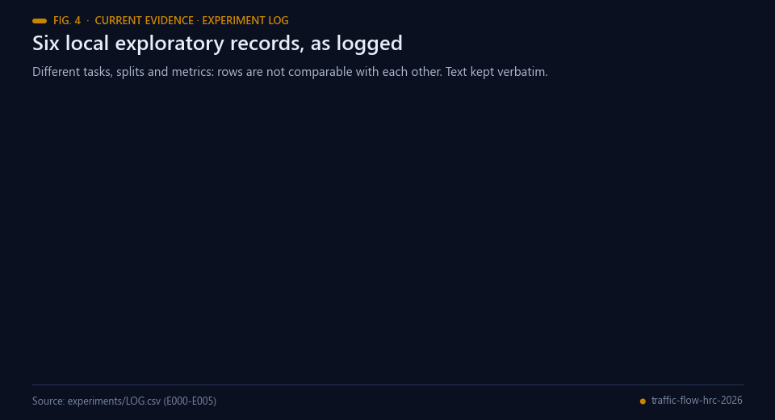<br><sub>Fig. 4 — Local exploratory records as logged in experiments/LOG.csv (decisions in the log's own words).</sub></p>

The historical server jobs were cancelled by their owner and work continued on the local CPU; this publication does not restart or cancel any job. Prize eligibility is unresolved because the separate organiser-email registration deadline may have passed. Kaggle membership alone is not proof of that registration or prize eligibility.

## Reproduce

<p align="center">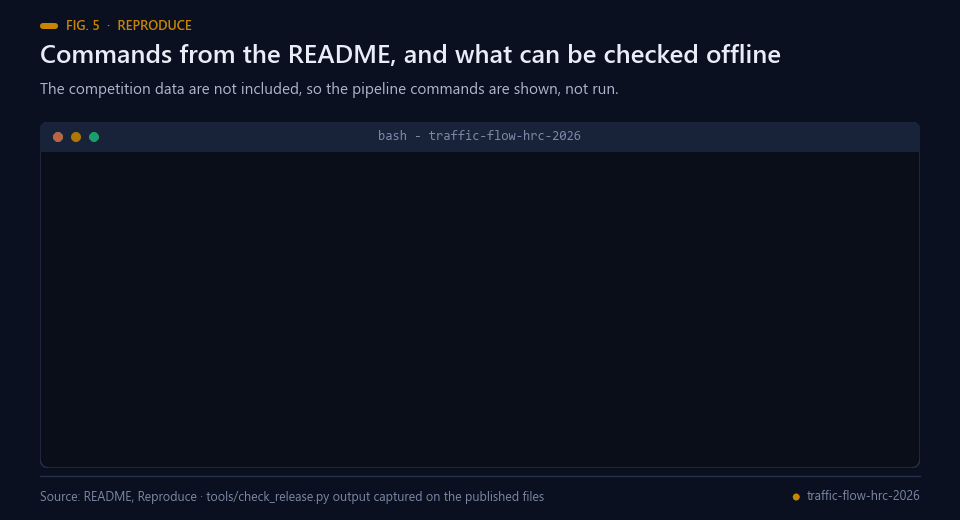<br><sub>Fig. 5 — README commands (not run: data not included) and a real run of <code>tools/check_release.py</code>.</sub></p>

```bash
python -m pip install -r code/requirements.txt
cd code
export TFB_REL=/path/to/kaggle_public
bash run_a.sh
bash run_b.sh 0
```

`run_a.sh` produces Task4 and Task1 results; `run_b.sh` produces Task2 with a specified reservoir size. The final merge command and exact inputs are in [implementation README](code/README.md). The current scripts use four CPU threads and fixed seeds. They require the authorised competition release; **data are not included**. The release is derived from calibrated simulated traffic, not a claim that every cell is a directly observed road measurement.

## Scientific comparison

<p align="center">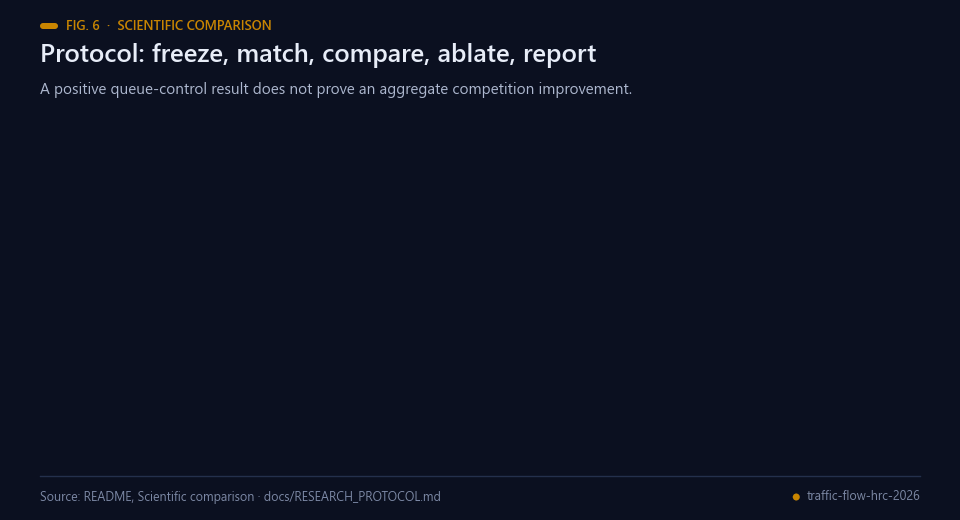<br><sub>Fig. 6 — The comparison protocol. Sources: this section and docs/RESEARCH_PROTOCOL.md.</sub></p>

Freeze chronological validation windows and official masks, match compute, then compare persistence, the feature-based control, and reservoir features with at least three seeds. Conservation features and reservoir states need separate ablations. Keep all subtasks and errors visible; a positive queue-control result does not prove an aggregate competition improvement.

Original contributions and the imported Holographic Reservoir retain Apache-2.0. Official helper code is not relicensed: its provenance and upstream terms are recorded in `code/official_src/`. See [research protocol](docs/RESEARCH_PROTOCOL.md). No official acceptance, rank or prize is claimed.

## Background

<p align="center">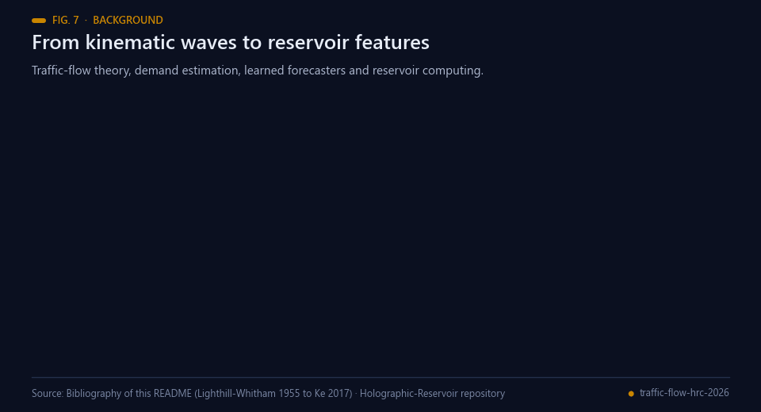<br><sub>Fig. 7 — Milestones behind this work. Sources: bibliography below.</sub></p>

Macroscopic traffic-flow modelling has a classical root in the kinematic-wave theory of Lighthill and Whitham and, independently, Richards
(the LWR model), which treats traffic as a conserved continuum [[1](#ref-1), [2](#ref-2)]. Daganzo's cell transmission model
discretises that theory into cells in which vehicles are counted in and out [[3](#ref-3)]; the vehicle-conservation
features used for Task 1 here follow the same bookkeeping idea (upstream flow plus net ramp flow), without
claiming to implement the cell transmission model. Demand is estimated from the other direction: origin-destination
matrices can be updated from observed link counts [[4](#ref-4)], and the non-negative least-squares machinery behind
Task 4 is classical [[5](#ref-5)].

Learned forecasters came later. Graph-based deep networks such as DCRNN and STGCN model traffic as a signal on a
road graph [[6](#ref-6), [7](#ref-7)]. This repository takes a lighter route: gradient-boosted trees [[10](#ref-10)] as the feature
control, optionally extended with reservoir features. Reservoir computing trains only a linear read-out on top of
a fixed recurrent network [[8](#ref-8), [9](#ref-9)]; the reservoir used here is the author's public Holographic Reservoir
[[11](#ref-11)], imported under `code/hrc/`.

The question this work asks is narrow: on the queue-prediction task of the IEEE Big Data Traffic Flow Bench
[[12](#ref-12)], do reservoir states add value over a strong feature control at matched compute? The repository's
current records do not answer it, because the reservoir comparison is incomplete.

## Real-world applications

<p align="center">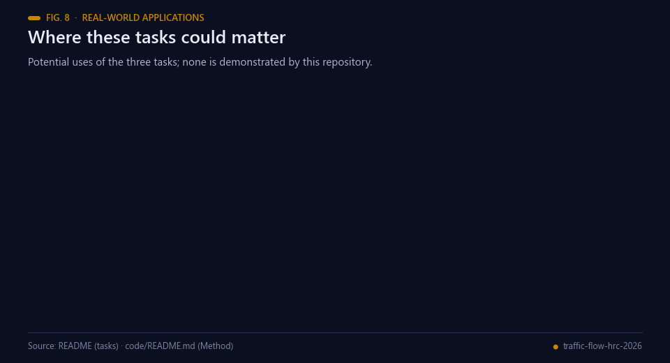<br><sub>Fig. 8 — Potential uses of the three tasks. None is demonstrated by this repository.</sub></p>

The tasks in this benchmark mirror problems that traffic operators face. If a method like this were validated on
real corridors, potential uses would include:

- **Sensor gap filling.** Reconstructing speed and flow on links whose detectors are masked or have failed (Task 1).
- **Queue early warning.** Flagging links likely to hold a queue at the next horizons so operators can act (Task 2).
- **Demand estimation.** Estimating origin-destination demand that is consistent with observed link counts (Task 4).
- **Planning studies.** Conservation-consistent state estimates as inputs to corridor planning and what-if analysis.
- **CPU-only pipelines.** The current scripts use four CPU threads and fixed seeds; deployment cost and latency
  have not been measured.
- **Benchmark practice.** A protocol for testing whether reservoir features add value over a strong feature
  control before they are adopted.

The release behind the benchmark is derived from calibrated simulated traffic, so all of these remain potential
until tested on observed road data.

## Possible improvements

<p align="center">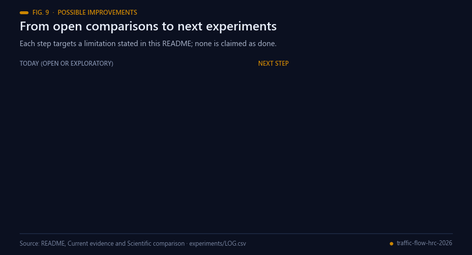<br><sub>Fig. 9 — Each improvement targets a limitation stated in this repository.</sub></p>

- **Finish the reservoir comparison.** The 32-unit comparison is incomplete, so no reservoir gain is demonstrated.
  Persistence, the feature control and the reservoir arm should run at matched compute with at least three seeds.
- **Finish state reconstruction.** The Task 1 runs are still incomplete; they should be completed under frozen
  chronological windows and the official masks, with every subtask reported.
- **Confirm the queue result.** The CPU control's holdout IoU of approximately 0.667 against approximately 0.41 for
  persistence is a single campaign-recorded, exploratory record; independent windows are needed before it is read
  as a general result.
- **Ablate each feature family.** Conservation features and reservoir states need separate ablations, with per-task
  errors kept visible.

## Future work

<p align="center">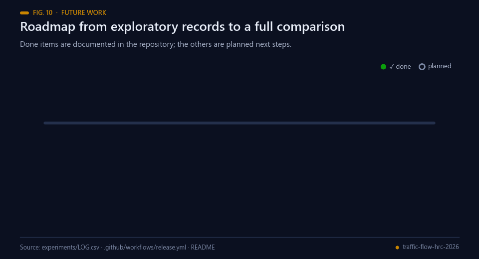<br><sub>Fig. 10 — Completed items are documented in this repository; the rest are planned.</sub></p>

Planned next steps, in order; none is claimed as started:

1. Complete the matched-compute comparison of persistence, the feature control and reservoir features, with at
   least three seeds.
2. Complete the state-reconstruction runs on all corridors under the official masks.
3. Run separate ablations for conservation features and for reservoir states.
4. Report all subtasks and errors together, and treat any aggregate claim as open until the three steps above are
   done.

## Bibliography

1. <a id="ref-1"></a>Lighthill, M. J., & Whitham, G. B. (1955). On kinematic waves II. A theory of traffic flow on long crowded roads. *Proceedings of the Royal Society of London. Series A. Mathematical and Physical Sciences*, 229(1178), 317–345. https://doi.org/10.1098/rspa.1955.0089
2. <a id="ref-2"></a>Richards, P. I. (1956). Shock Waves on the Highway. *Operations Research*, 4(1), 42–51. https://doi.org/10.1287/opre.4.1.42
3. <a id="ref-3"></a>Daganzo, C. F. (1994). The cell transmission model: A dynamic representation of highway traffic consistent with the hydrodynamic theory. *Transportation Research Part B: Methodological*, 28(4), 269–287. https://doi.org/10.1016/0191-2615(94)90002-7
4. <a id="ref-4"></a>Cascetta, E., & Nguyen, S. (1988). A unified framework for estimating or updating origin/destination matrices from traffic counts. *Transportation Research Part B: Methodological*, 22(6), 437–455. https://doi.org/10.1016/0191-2615(88)90024-0
5. <a id="ref-5"></a>Lawson, C. L., & Hanson, R. J. (1995). Solving Least Squares Problems. Society for Industrial and Applied Mathematics. https://doi.org/10.1137/1.9781611971217
6. <a id="ref-6"></a>Li, Y., Yu, R., Shahabi, C., & Liu, Y. (2017). Diffusion Convolutional Recurrent Neural Network: Data-Driven Traffic Forecasting. *arXiv* 1707.01926. https://arxiv.org/abs/1707.01926
7. <a id="ref-7"></a>Yu, B., Yin, H., & Zhu, Z. (2018). Spatio-Temporal Graph Convolutional Networks: A Deep Learning Framework for Traffic Forecasting. *Proceedings of the Twenty-Seventh International Joint Conference on Artificial Intelligence*, 3634–3640. https://doi.org/10.24963/ijcai.2018/505
8. <a id="ref-8"></a>Jaeger, H., & Haas, H. (2004). Harnessing Nonlinearity: Predicting Chaotic Systems and Saving Energy in Wireless Communication. *Science*, 304(5667), 78–80. https://doi.org/10.1126/science.1091277
9. <a id="ref-9"></a>Lukoševičius, M., & Jaeger, H. (2009). Reservoir computing approaches to recurrent neural network training. *Computer Science Review*, 3(3), 127–149. https://doi.org/10.1016/j.cosrev.2009.03.005
10. <a id="ref-10"></a>Ke, G., Meng, Q., Finley, T., Wang, T., Chen, W., Ma, W., Ye, Q., & Liu, T.-Y. (2017). LightGBM: A highly efficient gradient boosting decision tree. *Advances in Neural Information Processing Systems 30 (NIPS 2017)*. https://papers.nips.cc/paper_files/paper/2017/hash/6449f44a102fde848669bdd9eb6b76fa-Abstract.html
11. <a id="ref-11"></a>Angulo de Lafuente, F. (Agnuxo1). *Holographic-Reservoir* (public GitHub repository, Apache-2.0 code imported in `code/hrc/` of this repository). https://github.com/Agnuxo1/Holographic-Reservoir
12. <a id="ref-12"></a>IEEE Big Data Traffic Flow Bench (2026). Kaggle competition page. https://www.kaggle.com/competitions/2026-ieee-big-data-traffic-flow-bench

---

<div align="center">
<sub>Built by <a href="https://github.com/Agnuxo1">Francisco Angulo de Lafuente</a> · every figure is an animated
rendering of the published file named in its footer · <a href="#traffic-flow-bench--conservation-features-and-reservoir-ablations">back to top ↑</a></sub>
</div>
